# Terminator: System Design & Architecture Document

> **Course:** CS69201 · Computing Lab · Term Project  
> **Institution:** Department of Computer Science and Engineering, Indian Institute of Technology Kharagpur  
> **Author:** Niranjan Hebli

---

## Table of Contents
1. [Executive Architectural Overview](#1-executive-architectural-overview)
2. [GUI & Event Loop Architecture](#2-gui--event-loop-architecture)
3. [Concurrency Models & Shared State Synchronization](#3-concurrency-models--shared-state-synchronization)
4. [Shell Execution Engine & Plumbing (IPC)](#4-shell-execution-engine--plumbing-ipc)
5. [Signal Handling & Job Control Without a TTY](#5-signal-handling--job-control-without-a-tty)
6. [Core Data Structures & Memory Layout](#6-core-data-structures--memory-layout)
7. [Bash-Style Subsystems](#7-bash-style-subsystems)
8. [Starship-Style Status Bar & Prompt Engine](#8-starship-style-status-bar--prompt-engine)
9. [Edge Cases, Error Handling & Invariants](#9-edge-cases-error-handling--invariants)

---

## 1. Executive Architectural Overview

Terminator unifies two system software components typically implemented as separate binaries:
- **Terminal Emulator (GUI):** Connects to the X server, handles raw hardware input events, renders tab bars and in-memory text buffers, and drives the display.
- **Command Shell Engine:** Lexically analyzes command strings, manages environment state, resolves paths, configures process hierarchies, wires I/O streams, and manages foreground/background jobs.

```mermaid
graph TD
    UI_WIN["Window & Graphics Context"]
    UI_TAB["Tab Bar & Navigation"]
    UI_BUF["In-Memory Text Buffers"]

    PARSER["Lexer & Parser"]
    BUILTIN["Built-in Commands (cd, exit, jobs, ...)"]
    JOBTAB["Job Control Table"]
    HIST["Persistent History Ring"]

    PROC["Processes & Process Groups"]
    PIPES["Unix Pipes & File Descriptors"]
    SIG["Signal Delivery Subsystem"]
    SHM["POSIX Shared Memory & Semaphores"]

    UI_WIN -- "KeyPress Events" --> PARSER
    UI_BUF <-- "Stdout / Stderr via Pipes" -- BUILTIN
    PARSER -- "fork() / execvp()" --> PROC
    PARSER -- "pipe() / dup2()" --> PIPES
    PROC -- "waitpid() / Signals" --> JOBTAB

    classDef gui fill:#1e3a8a,stroke:#60a5fa,stroke-width:2px,color:#ffffff;
    classDef shell fill:#065f46,stroke:#34d399,stroke-width:2px,color:#ffffff;
    classDef kernel fill:#7c2d12,stroke:#fb923c,stroke-width:2px,color:#ffffff;

    class UI_WIN,UI_TAB,UI_BUF gui;
    class PARSER,BUILTIN,JOBTAB,HIST shell;
    class PROC,PIPES,SIG,SHM kernel;
```

### Core Invariant: Decoupled Shell Engine
The shell execution engine operates strictly on generic file descriptors (`stdin`, `stdout`, `stderr`) and character streams. It does not possess direct knowledge of X11 structures, allowing the exact same shell logic to power:
- Interactive GUI tabs in Thread Mode (`./terminator`)
- Interactive GUI tabs in Process Mode (`./terminator useProcess=True`)
- Headless script executions and pipeline stages (`./terminator --shell`)

---

## 2. GUI & Event Loop Architecture

### 2.1 X11 Client-Server Communication
Terminator functions as an X11 client communicating with an X server via the Xlib protocol:
- **Connection:** Established via `XOpenDisplay(NULL)`. If `$DISPLAY` is unconfigured or invalid, a fatal diagnostic is reported.
- **Window Hierarchy:** Created as a top-level window via `XCreateSimpleWindow()`.
- **Event Selection:** Registers `ExposureMask`, `KeyPressMask`, `ButtonPressMask`, and `StructureNotifyMask`.
- **Graphics Context (GC):** Configured with Catppuccin Mocha-inspired color palettes and monospace font structures (`XLoadQueryFont` with `9x15` fallback).

### 2.2 Unified Non-Blocking Event Multiplexing (`poll`)
A central design requirement is: **"Sleep, don't spin. Never freeze the window."**

Terminator implements a non-blocking, multiplexed event loop driven by `poll()`:

```c
struct pollfd pfds[1 + MAX_TABS];
// pfds[0] monitors the X11 connection socket descriptor
pfds[0].fd = ConnectionNumber(dpy);
pfds[0].events = POLLIN;

// pfds[1..N] monitor the stdout/stderr pipe read-ends of each tab
for (int i = 0; i < tab_count; i++) {
  pfds[1 + i].fd = tabs[i].out_fd;
  pfds[1 + i].events = POLLIN;
}

int ret = poll(pfds, 1 + tab_count, timeout_ms);
```

#### Event Loop Principles:
1. **Zero CPU Spinning:** When idle, `poll()` halts the GUI process in the kernel scheduler. CPU usage remains at ~0.0%.
2. **Asynchronous Drainage:** When `pfds[0]` signals data, pending X events are drained in a tight loop using `XPending(dpy)` and `XNextEvent()`.
3. **Concurrent Background Tab Output:** When child tabs produce output (`pfds[1 + i]`), bytes are read in chunks (up to 4096 bytes) and appended to the respective tab's in-memory line buffer (`tab_append_text()`), even when that tab is hidden in the background.
4. **Single-Threaded Xlib Invariant:** All Xlib calls are isolated strictly to the master GUI thread, preventing multi-threaded reentrancy collisions without requiring global display lock overhead.

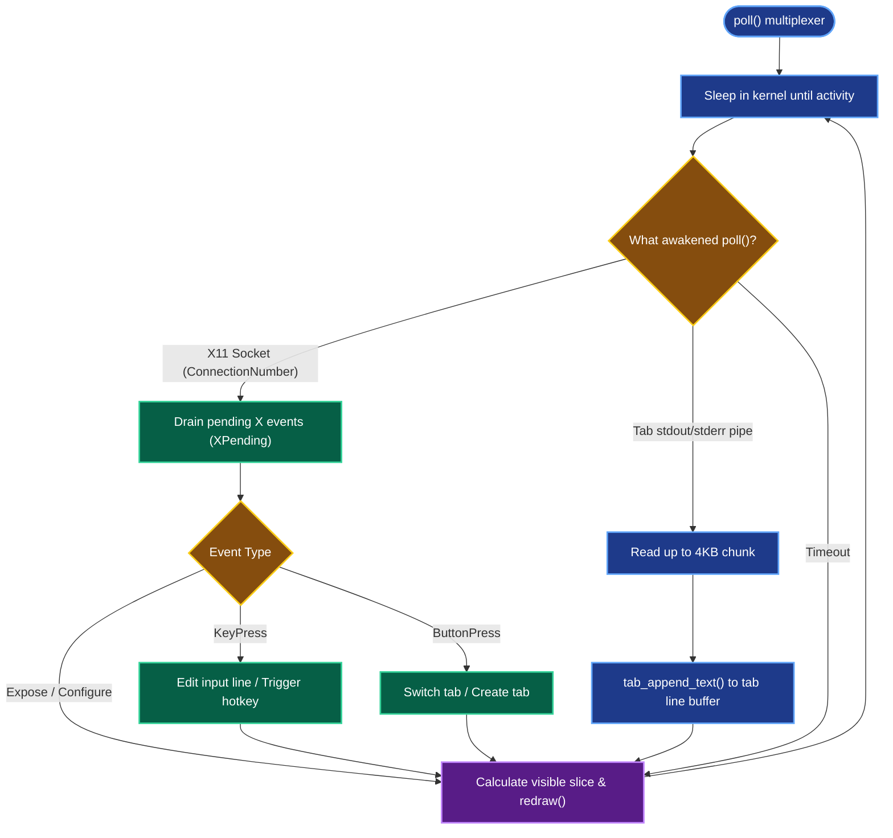

### 2.3 Background Tab Activity Notifications & Audible Bell
Terminator continuously monitors pipe descriptors and process states for hidden background tabs:
- **Unread Activity Indicators:** When a background tab receives stdout/stderr data or when a background job finishes execution, `tabs[i].unread_activity` is flagged.
- **Tab Bar Visual Badge:** `redraw()` paints a circular notification dot on the tab bar in `col_tab_active_fg` to alert the user of new activity without requiring tab switching.
- **Audible Alerts:** Dispatches `XBell(dpy, 0)` upon background activity or task completion.
- **Automatic Dismissal:** Clicking or switching to the tab immediately clears the unread badge.

---

## 3. Concurrency Models & Shared State Synchronization

Terminator supports two distinct execution models that exhibit identical user-facing behavior.

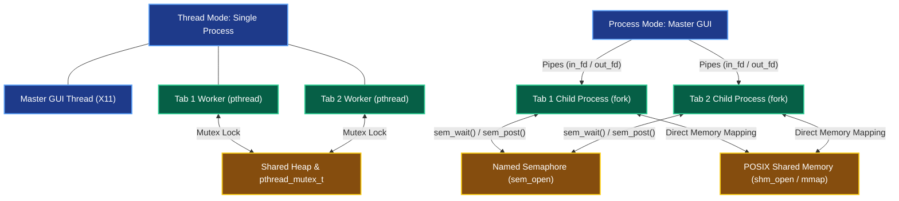

### 3.1 Thread Mode (Default: `./terminator`)
- **Process Architecture:** A single Unix process hosting a master GUI thread and one POSIX worker thread (`pthread_create`) per tab.
- **Tab Isolation:**
  - Working directory (`tab_cwd`) and exit status (`$?`) are declared thread-local (`_Thread_local`), preventing cross-tab interference.
  - Because `chdir()` is process-wide in POSIX, the master process preserves a virtual per-tab `tab_cwd`. Before any child process is `execvp`'d, child setup calls `chdir(tab_cwd)` in the forked process space.
- **Shared Memory:** Heap-allocated `SharedState` structure guarded by a `pthread_mutex_t` (`PTHREAD_MUTEX_RECURSIVE`).

### 3.2 Process Mode (`./terminator useProcess=True`)
- **Process Architecture:** The GUI is the parent process. Each tab is spawned as an independent child process via `fork()`.
- **Fault Tolerance:** If a command in one tab triggers a crash (e.g., `SIGSEGV`), the parent GUI and all other tabs remain unharmed.
- **Shared Memory Implementation:**
  - Shared state is mapped into anonymous POSIX shared memory using `shm_open()` with `O_CREAT | O_RDWR` and sized via `ftruncate()` to `sizeof(SharedState)`.
  - Memory is mapped into each process address space via `mmap(NULL, sizeof(SharedState), PROT_READ | PROT_WRITE, MAP_SHARED, shm_fd, 0)`.
  - The shared memory object name is immediately unlinked (`shm_unlink()`) so no leaked files remain on disk upon termination.
- **Synchronization Primitives:**
  - Concurrency is governed by a POSIX named semaphore created via `sem_open()` initialized to value `1`.
  - The semaphore is similarly unlinked (`sem_unlink()`) immediately after initialization.
  - Locking operations wrap critical sections via `sem_wait()` and `sem_post()`.

### 3.3 State Partitioning Table

| Resource | Scope | Storage Mechanism | Synchronization |
| :--- | :--- | :--- | :--- |
| **Command History** | Shared | Ring buffer in `SharedState` | `pthread_mutex` / `sem_t` |
| **Clipboard Buffer** | Shared | Character array in `SharedState` | `pthread_mutex` / `sem_t` |
| **Foreground PGID** | Shared | Atomic array `fg_pgid[MAX_TABS]` | `__atomic` operations |
| **Execution Timing**| Shared | Atomic arrays `last_duration_ms` / `last_status` | `__atomic` operations |
| **Working Directory**| Private | Per-tab `cwd[PATH_MAX]` / `_Thread_local` | Tab private |
| **Line Buffer** | Private | In-memory 2D array `lines[1000][512]` | Tab private |
| **Job Control Table**| Private | Per-tab array `Job jobs[MAX_JOBS]` | Tab private |
| **Exit Status ($?)** | Private | `last_status` variable | Tab private |

---

## 4. Shell Execution Engine & Plumbing (IPC)

### 4.1 Command Lifecycle (`fork` $\to$ `exec` $\to$ `wait`)
1. **Forking:** The shell forks a child process.
2. **Child Execution (`child_setup`):**
   - Resets signal handlers (`SIGPIPE`, `SIGINT`, `SIGTSTP`) to `SIG_DFL`.
   - Invokes `chdir(tab_cwd)` to set the tab's working directory.
   - Wires redirected file descriptors to `STDIN_FILENO`, `STDOUT_FILENO`, and `STDERR_FILENO`.
   - Replaces the process image with `execvp(argv[0], argv)`. If `execvp()` returns, the child immediately calls `_exit(127)`.
3. **Parent Reaping:** The parent shell waits using `waitpid(pid, &status, WUNTRACED)` and records the exit status in `$?`.

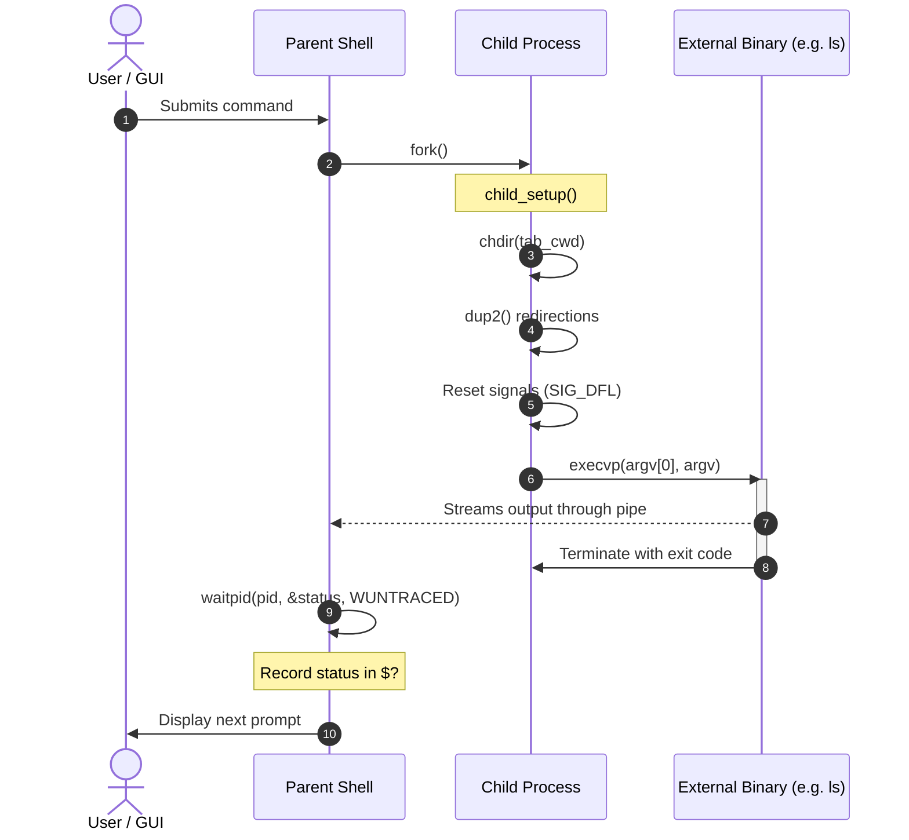

### 4.2 I/O Redirection Engine
Redirection operators (`<`, `>`, `>>`) are resolved before execution in the forked child process only:
- `< file`: Opens target with `O_RDONLY` and invokes `dup2(fd, STDIN_FILENO)`.
- `> file`: Opens target with `O_WRONLY | O_CREAT | O_TRUNC` and invokes `dup2(fd, STDOUT_FILENO)`.
- `>> file`: Opens target with `O_WRONLY | O_CREAT | O_APPEND` and invokes `dup2(fd, STDOUT_FILENO)`.
- **Error Handling:** If a file cannot be opened, the child reports `errno` diagnostics on `stderr` and terminates with status `1`. The parent shell descriptor table is never altered.

### 4.3 Multi-Stage Pipeline Architecture (`cmd1 | cmd2 | ... | cmdN`)
For a pipeline of $N$ commands:
1. **Pipe Creation:** Allocates $N - 1$ Unix pipe pairs via `pipe()`.
2. **Process Group Unification:** The first child sets its process group ID equal to its PID (`setpgid(pid, pid)`). All subsequent children join the same process group (`setpgid(child_pid, pgid_stage1)`).
3. **Plumbing (`dup2`):**
   - Stage $0$: stdout redirected to `pipe[0][1]`.
   - Stage $k$ ($0 < k < N-1$): stdin redirected to `pipe[k-1][0]`, stdout to `pipe[k][1]`.
   - Stage $N-1$: stdin redirected to `pipe[N-2][0]`.
4. **File Descriptor Cleanup Invariant:** Crucially, both the children and the parent close all unused pipe ends. If a single write end remains unclosed in the parent, the downstream reader will never observe EOF, deadlocking the pipeline.
5. **Reaping & Status Tracking:** The parent waits for all $N$ processes; the return code of the last command (Stage $N-1$) becomes the exit status `$?` of the pipeline.


### 4.4 Parallel Multi-Command Monitor (`multiWatch`)
The `multiWatch ["cmd1", "cmd2", ...]` built-in runs multiple shell commands in parallel:
- Creates an independent pipe pair for each command.
- Spawns each command concurrently via `fork()` and executes it through the full shell parser.
- Drives a dedicated `poll()` loop across all pipe read-ends, flushing arriving text blocks with the specified header:
  ```text
  "cmd", timestamp:
  ----------------------------------------------------
  <chunk output>
  ----------------------------------------------------
  ```
- When `Ctrl+C` is pressed, the shell issues `SIGKILL`/`SIGINT` to all child process groups and cleanly returns to the prompt.

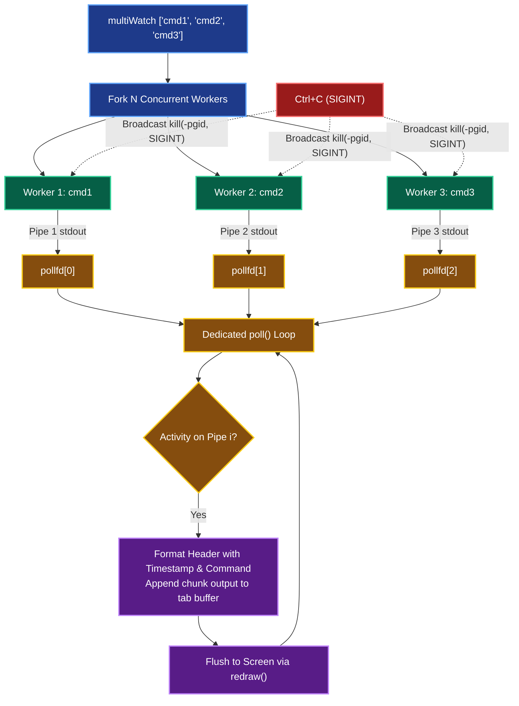

---

## 5. Signal Handling & Job Control Without a TTY

### 5.1 Signal Routing Without a Kernel TTY
In standard terminal emulators, the Linux kernel TTY line discipline automatically converts keystrokes like `\003` into `SIGINT` signals for the foreground process group. In Terminator, there is no pseudo-terminal (PTY) layer; the GUI receives raw X11 `KeyPress` events.

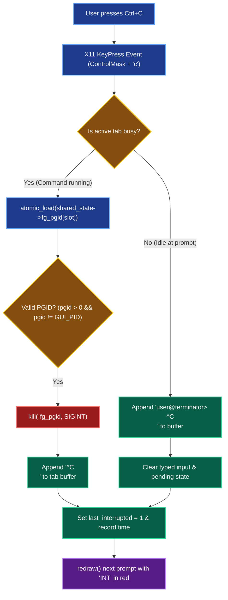

### 5.2 Foreground Group Tracking
To safely deliver signals without race conditions:
- Each tab publishes its active foreground process group ID in `shared_state->fg_pgid[tab_slot]` using atomic sequentially-consistent memory operations (`__atomic_store_n`, `__atomic_load_n`).
- The GUI checks `fg_pgid`. If non-zero and valid, it issues `kill(-pgid, sig)`.
- The GUI explicitly validates that `pgid != getpid()` and `pgid > 0`, ensuring Terminator itself can never accidentally signal or terminate its own process.

### 5.3 Job State Transitions & Table

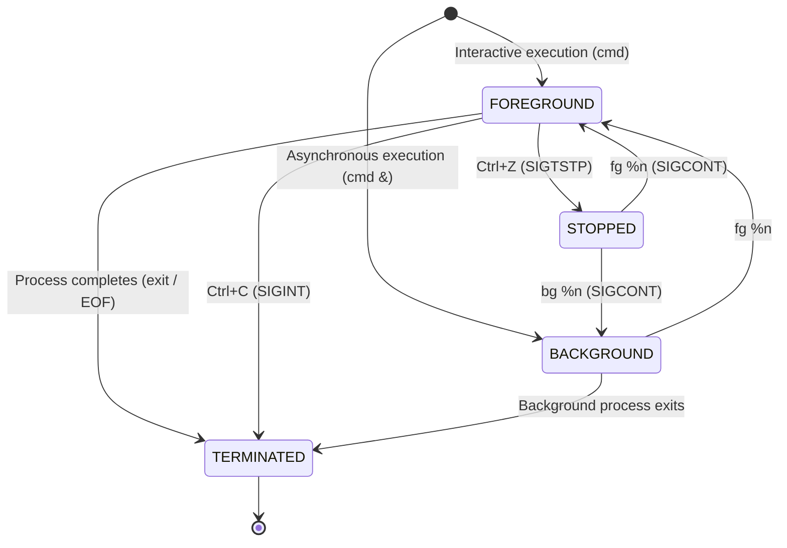

- **`Ctrl+Z` (`SIGTSTP`):** Sent to the foreground group `-pgid`. `waitpid(-pgid, &status, WUNTRACED)` detects the stop. The process group is registered in the tab's `Job` table, and `[1]+ Stopped <cmd>` is printed.
- **`jobs`:** Displays all background and stopped jobs with their job ID, state, and command name.
- **`bg %n`:** Sends `SIGCONT` to job $n$ and marks its state as `JOB_BACKGROUND`.
- **`fg %n`:** Sends `SIGCONT` to job $n$, installs its PGID as the foreground job, and blocks via `waitpid()`.
- **`cmd &`:** Forks the process in a new process group, redirects its `stdin` to `/dev/null` (preventing keyboard contention), prints `[job_id] pid`, and immediately returns to the shell prompt.

---

## 6. Core Data Structures & Memory Layout

### 6.1 Shared State (`SharedState`)
Guarded by mutex (Thread Mode) or named semaphore (Process Mode):

```c
typedef struct {
  // Concurrency & Synchronization
  pthread_mutex_t shared_mutex; // Used in thread mode
  int initialized;

  // Inter-Tab Clipboard
  char clipboard[4096];

  // Global Command History Ring Buffer (10,000 commands)
  char history[MAX_HISTORY][MAX_HIST_LEN];
  int history_count;
  int history_head;

  // Atomic Per-Tab Execution Tracking
  _Atomic int fg_pgid[MAX_TABS];
  _Atomic int busy[MAX_TABS];
  _Atomic long last_duration_ms[MAX_TABS];
  _Atomic int last_status[MAX_TABS];
  _Atomic int last_interrupted[MAX_TABS];
  char last_time[MAX_TABS][32];
} SharedState;
```

### 6.2 Per-Tab State (`Tab`)
Private to each tab:

```c
typedef struct {
  int id;                     // Visual tab number (1..N)
  pid_t pid;                  // Worker process ID (Process Mode)
  int in_fd;                  // Pipe write-end (GUI -> Shell stdin)
  int out_fd;                 // Pipe read-end (Shell stdout/stderr -> GUI)
  char title[32];             // Visual tab title (e.g., "1: tab")
  char cwd[PATH_MAX];         // Current working directory
  
  // Interactive Input Line Editing
  char input[1024];           // Active typed input buffer
  int input_len;
  int input_pos;              // Cursor column position
  char pending[MAX_CMD_LEN];  // Multiline accumulated buffer
  int pending_len;
  
  // History & Autocomplete State
  int hist_pos;               // Up/Down browsing offset
  char saved_input[1024];     // Preserved half-typed line
  int completing;             // 1 = waiting for numeric selection (1..9)
  char comp_matches[64][256];
  int comp_count;
  int comp_replace_start;
  int unread_activity;        // 1 = background tab has new output or finished a job
  
  // Terminal Display Buffer
  char lines[MAX_LINES][MAX_LINE_LEN]; // 1000 lines x 512 chars
  int line_count;
} Tab;
```

### 6.3 Data Structure Relationships & Memory Layout

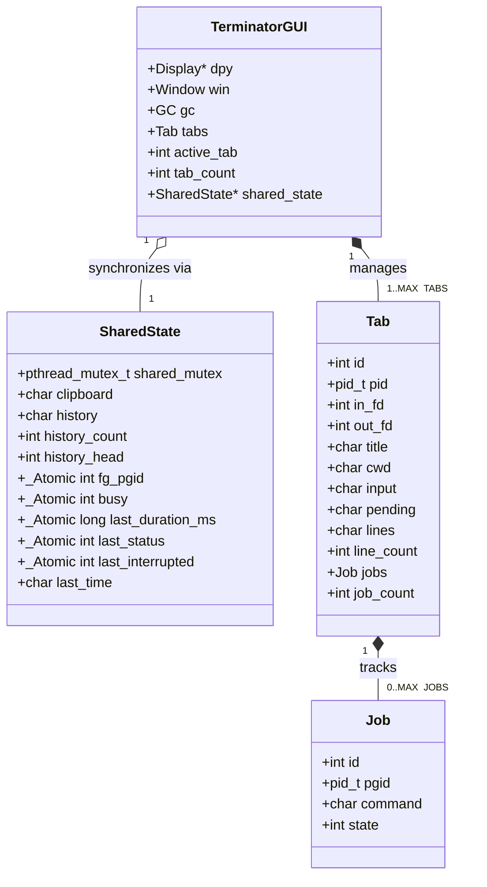

---

## 7. Bash-Style Subsystems

### 7.1 Parser, Quoting & Variable Expansion
- **Quoting Rules:**
  - `'single'`: Completely literal; disables variable expansion, escape characters, and operators.
  - `"double"`: Preserves whitespace; expands `$VAR`, `${VAR}`, `$?`, `$$`, and nested command substitution `$(...)`.
  - `\`: Escapes the subsequent character.
- **Multiline Input (`input_status`):** If an input buffer contains an open quote, a trailing backslash, or an open `$(`, the shell and GUI present the continuation prompt `> ` and accumulate lines until syntax is complete.
- **Command Substitution (`$(cmd)`):** Evaluated recursively from innermost to outermost. Spawns an internal subshell pipe, captures stdout into an in-memory buffer, strips trailing newlines, and splices the text into the command string.

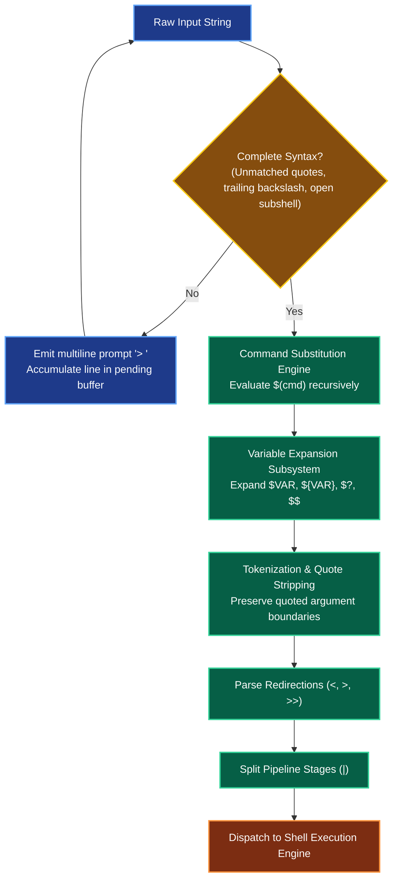

### 7.2 Keybinding Engine & `~/.terminatorrc`
Default bindings conform to standard readline:
- Navigation: `←` / `→` (character), `Ctrl+A` (home), `Ctrl+E` (end)
- Editing: `Ctrl+W` (delete word), `Ctrl+U` (delete to start), `Ctrl+K` (delete to end), `Ctrl+L` (clear screen)
- Tabs & Clipboard: `Ctrl+T` (new tab), `Ctrl+D` (close tab / EOF), `Ctrl+Shift+C` (copy), `Ctrl+Shift+V` (paste)

Bindings are fully configurable without recompilation via `~/.terminatorrc`:
```text
bind clear-screen Ctrl+Shift+L
bind delete-word Alt+Backspace
```
Malformed or unrecognized binding lines log a warning on `stderr` and preserve default bindings.

### 7.3 Persistent History & Reverse Search (`Ctrl+R`)
- **Persistence:** Commands are appended to `~/.terminator_history` on submission and restored on launch (up to 10,000 commands).
- **Reverse Search Mode (`Ctrl+R`):**
  1. Exact substring match: locates the most recent matching history entry.
  2. Longest common substring match: if no exact match is found, returns entries matching the longest substring greater than 2 characters.
  3. No match: outputs `No match for search term in history`.

### 7.4 Tab Filename Completion
Pressing `Tab` tokenizes the word before the cursor:
1. **Single Match:** Expands the filename immediately in-line.
2. **Multiple Matches:** Expands input to the Longest Common Prefix (LCP), then prints a numbered candidate list (`1. fileA  2. fileB`) and awaits a numeric key selection (`1`..`9`).
3. **No Match:** Audio/visual pass-through; leaves input unchanged.

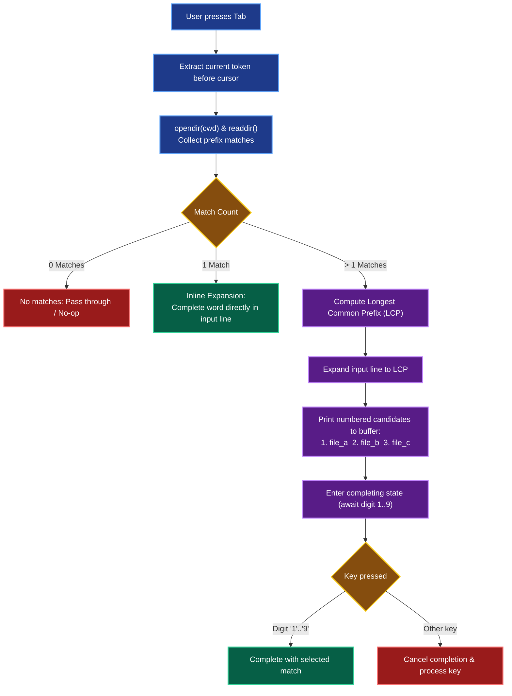

### 7.5 Native Shell Scripting Engine
Terminator executes scripts (`./check.sh`, `bash check.sh`, `source check.sh`) natively without delegating to `/bin/bash`:
- **Variables & Positional Parameters:** Handles assignment (`VAR=value`), positional parameters (`$1`..`$9`), argument count (`$#`), and status (`$?`).
- **Control Flow:** Nested `if` / `elif` / `else` / `fi` blocks.
- **`[` Test Expressions:** Evaluates file tests (`-f`, `-d`, `-e`), string tests (`=`, `!=`, `-z`, `-n`), and arithmetic comparisons (`-eq`, `-ne`, `-lt`, `-le`, `-gt`, `-ge`).
- **Non-Fatal Script Termination:** An `exit n` inside a script terminates script interpretation with code `n` while keeping the parent terminal tab active.

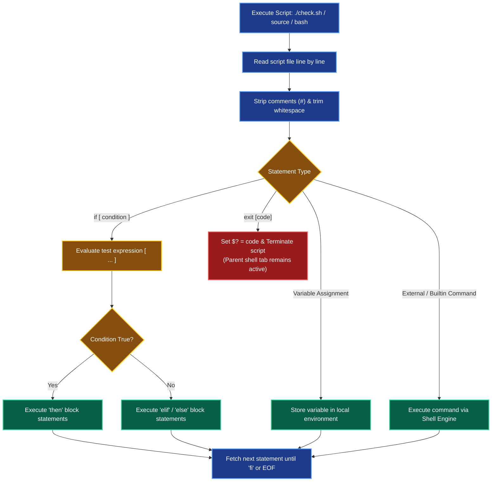

### 7.6 Command & Subcommand "Did You Mean?" Typo Suggestion Engine
Terminator integrates a fuzzy typo suggestion subsystem based on the Damerau-Levenshtein distance metric (accounting for character insertion, deletion, substitution, and transposition):
- **Command Typo Correction:** When a command fails with `_exit(127)` (`command not found`), the engine scans all built-in commands and executable binaries in `$PATH`. If a candidate within edit distance $\le 2$ ($\le 1$ for short tokens) is found, the shell prints:
  ```text
  terminator: sl: command not found. Did you mean 'ls'?
  ```
- **Subcommand Typo Correction:** If a supported multi-command CLI (`git`, `docker`, `podman`, `apt`, `npm`, `pnpm`, `yarn`, `cargo`) exits with a non-zero status due to an unrecognized subcommand, Terminator identifies the closest valid subcommand:
  ```text
  terminator: 'git cmmit' failed. Did you mean 'git commit'?
  ```

### 7.7 Live Syntax Highlighting & Ghost Autosuggestions
Terminator features real-time interactive input feedback directly in the X11 graphics context:
- **Real-Time Command Highlighting:** As characters are typed into the input buffer, `is_valid_command()` inspects the initial command token. Recognized built-ins, scripts, and binaries discovered in `$PATH` are drawn in green (`#a6e3a1`), while unrecognized tokens are drawn in red/pink (`#f38ba8`).
- **Quote Syntax Highlighting:** Single-quoted (`'...'`) and double-quoted (`"..."`) strings are styled dynamically in peach (`#fab387`).
- **Fish-Style Ghost Autosuggestions:** `get_ghost_suggestion()` queries persistent history for the latest matching prefix. The suggested command tail is drawn inline ahead of the cursor in dimmed text (`#6c7086`).
- **One-Key Acceptance:** Pressing the Right Arrow (`→`) key at the end of the line accepts the ghost suggestion immediately into the active input line.

---

## 8. Starship-Style Status Bar & Prompt Engine

### 8.1 Status Bar Geometry & Components
To provide rich terminal aesthetics, Terminator features a modern two-pill status bar:
- **Left Pill:** Background `#242535`. Displays abbreviated directory (`~/Desktop/terminal_demo` via `abbreviate_path()`) in soft blue `#89b4fa`, followed by git branch (`| on main` parsed directly from `.git/HEAD`) in soft green `#a6e3a1`.
- **Connector Line:** Draws dynamic dashes (`------`) in `#6c7086` adapting automatically to window resize events (`ConfigureNotify`).
- **Right Pill:** Background `#242535`. Displays command timing (`took 1s` via monotonic clock `clock_gettime(CLOCK_MONOTONIC)`), interrupt flags (`INT` in red `#f38ba8`), non-zero error codes (`ERR <status>`), and completion timestamp (`at 06:38:29 PM`) in teal `#94e2d5`.
- **Input Prompt:** Clean prompt rendered immediately below as `user@terminator> `.

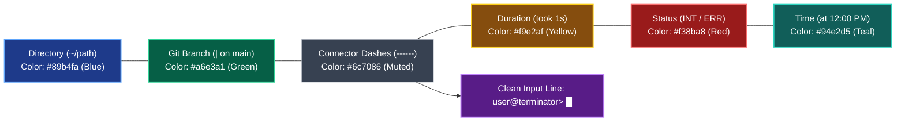

### 8.2 Scrollback History Persistence
To prevent status information from disappearing once a command finishes:
- Status bars are committed directly into the tab's historical line buffer (`cur->lines`) when a command is submitted on `XK_Return` or interrupted on `Ctrl+C`.
- The line is stored using an internal marker format:
  `\001[BAR]\001<cwd>\t<branch>\t<dur_str>\t<time_str>\t<right_is_err>`
- When `redraw()` renders the visible line slice (`start_line` to `line_count`), it parses bar lines and invokes `draw_status_bar()`, ensuring historical status bars remain permanently visible in scrollback history with identical Catppuccin pill geometry and colors.

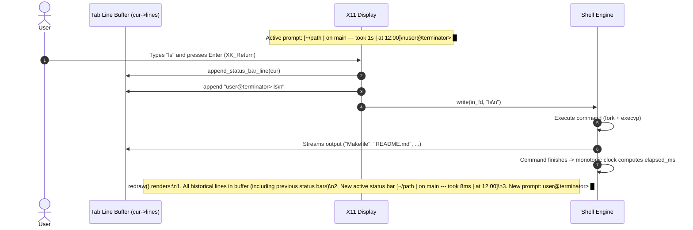

---

## 9. Edge Cases, Error Handling & Invariants

1. **Window Resize Handling:** Dynamically calculates visible lines from bottom-up based on variable line heights (`char_height` for text, `char_height + 6` for status bars), ensuring the active prompt is never pushed off-screen.
2. **Zombie Process Prevention:** Background processes are reaped synchronously or in periodic sweeps; foreground pipelines are reaped via explicit `waitpid()` loops.
3. **Signal Isolation:** The GUI strictly prevents signaling `pgid <= 0` or its own PID.
4. **IPC Buffer Limits:** Pipes are non-blocking where appropriate, and buffers are drained continuously in `poll()` to prevent pipe buffer saturation (typically 64KB on Linux/macOS).
5. **Clean Exit:** Closing the final tab cleanly unlinks shared semaphores/memory and terminates the X11 connection without resource leaks.
